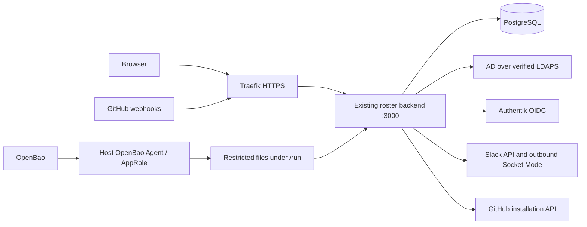

# Deployment: roster backend, Slack, GitHub, and OpenBao

Last reviewed: 2026-10-23. Audience: the roster operator and KRG infrastructure maintainers.

This runbook describes the integrated backend and the changes needed to deploy it on `krg-prod`. It is not evidence of a production deployment or successful live-provider testing. Application behavior has been exercised with isolated databases and simulated providers. Use [integrations-prototype.md](integrations-prototype.md) for the local demo.

## 1. Release status and scope

The server runs **one roster backend and PostgreSQL**. Slack Socket Mode, GitHub clients/webhooks, onboarding, and background jobs all run inside that backend. Do not deploy the historical `slackbot` or `github-app` services or expose ports 3001/3002.

The backend image builds and runs on Node.js 24.22.1 LTS (`node:24.22.1-bookworm-slim`). Rebuild the image and recreate the backend to change the running Node version; updating the host's Node package does not update the container.

| Capability | Current status |
|---|---|
| Per-organization Slack workspace and GitHub organization | Implemented; no global credential fallback |
| Group → Slack channel / GitHub team mappings, preview and apply | Implemented; grants access, does not revoke it |
| Weekly Slack discovery, personal browser onboarding, one-time join notification | Implemented; opt-in per organization |
| Shared-account expiration extension | Implemented; updates AD and PostgreSQL; not one atomic transaction |
| Provider secrets encrypted in PostgreSQL | Implemented; AES-256-GCM, shared application key |
| OpenBao Agent → runtime environment files | Wiring prepared in [infra PR #607](https://github.com/KastnerRG/krg-infra/pull/607); host activation remains pending |
| `ENCRYPTION_KEY_FILE` | **Not implemented**; setting it alone will not configure encryption |
| OpenBao Transit encryption | **Not implemented**; an alternative future design, not a deployment switch |
| Agreement signing / prerequisite checks / direct repository grants / GitHub OAuth ownership verification | Not implemented |

### Before a real server trial

Release scope confirmed by the project owner on 2026-10-23: retain the existing LDAP certificate-verification setting, MemoryStore sessions, and session-cached authorization roles for this release. They are pre-existing behavior and are not prerequisites for the integration rollout.

- LDAP currently uses `rejectUnauthorized: false`; this release does not change directory trust configuration.
- Sessions remain in process memory. Backend restarts require users to sign in again.
- Authorization roles remain in sessions. Role changes are not guaranteed to take effect in an already authenticated browser session.
- The dependency update pins `body-parser` 1.20.9 and `http-cache-semantics` 4.3.0 through the lockfile. Rerun the dependency audit and application tests for the release revision.
- Preserve PostgreSQL and its matching encryption key together. Directory expiration writes and database writes remain separate operations.

Do not expose the auto-authenticated demo server or deploy with `SKIP_OIDC=true`. The demo is not a production entry point.

## 2. Architecture and trust boundaries



- A person can belong to E4E, KRG, or both. Each organization owns its provider configuration and group destinations.
- Slack links are scoped to the roster organization/workspace. A global GitHub username may be shared across the person's memberships; organization/team grants remain scoped.
- Expiration belongs to the shared AD account. An authorized extension in either workspace affects that account across organizations; it does not add groups or elevate roles.
- The application reads PostgreSQL, so it can obtain decrypted provider tokens while operating. Encryption protects a database-only disclosure; it does not protect against a fully compromised backend.

| Endpoint / port | Exposure |
|---|---|
| Public HTTPS 443 | Browser UI, `/auth/callback`, `/connect/slack`, signed `/webhooks/github/<org-id>` |
| Backend 3000 | Traefik and optionally host loopback; no public direct binding |
| PostgreSQL 5432 | Docker internal network only |
| Slack Socket Mode | Outbound connection; no inbound Slack endpoint or tunnel required |
| OpenBao 8200 | Existing infrastructure access; the backend does not need direct access in the Agent design |

Allow backend egress to Authentik, AD, Slack HTTPS/WebSocket endpoints, and GitHub HTTPS endpoints. Allow the host Agent to reach OpenBao with TLS verification. Avoid logging raw onboarding-link paths in the reverse proxy: those URLs contain short-lived bearer tokens. Log a redacted route or disable access logging for that path. GitHub webhooks require their original body and signature headers to reach the backend unchanged.

## 3. Infrastructure files and deployment inputs

The infrastructure checkout is `KRG-NixOS-Flakes`. Relevant paths there:

| File | Responsibility |
|---|---|
| `nix/hosts/krg-prod/default.nix` | `krg.composeStacks.e4e-roster`, runtime secret renders, service ordering |
| `nix/modules/services/vault-agent.nix` | Existing AppRole → `/run` template mechanism |
| `nix/modules/services/compose-stack.nix` | Compose systemd unit and recreation behavior |
| `terraform/secrets/roster.tf` | Early generation of DB/session/LDAP/OIDC credentials |
| `terraform/authentik/roster_secrets.tf` | Relinquish previous state ownership without destroying live entries |
| `terraform/authentik/vault_secrets.tf` | Read roster OIDC credentials from the early secrets workspace |
| `terraform/openbao/main.tf` | AppRole policies, including host read access to `secret/data/krg-prod/*` |
| `nix/docker-compose/e4e-roster/runtime-secrets.override.yml` | Runtime environment files for the integrated backend |

The current roster working directory on the server is `/var/lib/krg/e4e-roster`. Preserve its Compose project identity and existing database volume. Record the deployed application revision, infrastructure revision, Compose version, actual database volume, and provider test organization IDs in the change record.

Use the normal reviewed infrastructure deployment procedure. Do not substitute an unreviewed `nixos-rebuild` or `tofu apply` for it. This guide does not authorize pushing branches, merging, modifying live secrets, or deploying.

## 4. OpenBao setup compatible with the current application

For this rollout, the operator completed credential adoption into `terraform/secrets`, removed the old Authentik state ownership, and confirmed both plans show no changes. `secret/krg-prod/roster-crypto` version 1 was created and its 64-hex-character key format validated. Do not generate another key for this deployment. The instructions below remain a reference for fresh setup/recovery.

### 4.1 Secret ownership

Keep provider credentials in the organization Settings UI; the backend encrypts them into `org_integrations`. Keep the application encryption key and bootstrap service credentials in OpenBao.

| KV-v2 CLI path | Fields | Ownership |
|---|---|---|
| `secret/krg-prod/authentik-managed/roster` | `db_password`, `session_secret` | Early `terraform/secrets` workspace |
| `secret/krg-prod/authentik-managed/roster-oidc` | `client_id`, `client_secret` | Early `terraform/secrets` workspace; Authentik reads it |
| `secret/krg-prod/authentik-managed/roster-ldap` | `bind_password` | Early `terraform/secrets` workspace |
| `secret/krg-prod/roster-crypto` | `encryption_key` | Operator-managed; seeded once for this rollout |

The proposed crypto path deliberately has no application write permission. The existing host AppRole read policy covers it, but the operator who seeds it needs separately authorized create access. Do not hand the backend the broad host AppRole, deploy credentials, or an OpenBao root token. Host Agent secret-zero delivery already exists in the infrastructure; reuse it.

Do not manually overwrite Terraform-owned secret paths. In particular, changing a database password in KV does not change an existing PostgreSQL role's password.

### 4.2 Seed or import the encryption key

If encrypted integration records already exist, import **the same encryption key** into OpenBao. Do not generate a replacement unless all affected provider credentials will be re-entered or a tested re-encryption procedure exists.

For an actually fresh installation, an authorized operator can seed a key without printing it or putting it in command arguments/history:

```bash
# Only for a NEW crypto path and a NEW encryption-key domain.
# Authenticate using the approved operator workflow before this command.
set -o pipefail
openssl rand -hex 32 | tr -d '\n' | \
  bao kv put -cas=0 -mount=secret krg-prod/roster-crypto encryption_key=-
```

`-cas=0` prevents overwriting an existing KV-v2 entry. Do not work around that failure by deleting the existing entry. Import an existing key through protected stdin instead of an inline command argument. The key must be exactly 64 hexadecimal characters after parsing. Back it up through the approved OpenBao recovery procedure before saving integration credentials.

OpenBao CLI paths omit `/data/`; Agent KV-v2 template/API paths include it. See [KV put](https://openbao.org/docs/commands/kv/put/).

### 4.3 Render runtime files with the existing host Agent

**Prepared in infra PR #607; host activation is still pending.** These entries belong in the existing `krg.vaultAgent.renders` list on `krg-prod`. No secret value belongs in Nix source or the Nix store.

```nix
{
  destination = "/run/krg/roster/backend.env";
  perms = "0600";
  dirPerms = "0700";
  contents = ''
    {{ with secret "secret/data/krg-prod/authentik-managed/roster" }}
    DB_PASSWORD={{ .Data.data.db_password }}
    SESSION_SECRET={{ .Data.data.session_secret }}
    {{ end }}
    {{ with secret "secret/data/krg-prod/authentik-managed/roster-oidc" }}
    OIDC_CLIENT_ID={{ .Data.data.client_id }}
    OIDC_CLIENT_SECRET={{ .Data.data.client_secret }}
    {{ end }}
    {{ with secret "secret/data/krg-prod/authentik-managed/roster-ldap" }}
    LDAP_BIND_PASSWORD={{ .Data.data.bind_password }}
    {{ end }}
    {{ with secret "secret/data/krg-prod/roster-crypto" }}
    ENCRYPTION_KEY={{ .Data.data.encryption_key }}
    {{ end }}
  '';
}
{
  destination = "/run/krg/roster/compose.env";
  perms = "0600";
  dirPerms = "0700";
  contents = ''
    {{ with secret "secret/data/krg-prod/authentik-managed/roster" }}
    DB_PASSWORD={{ .Data.data.db_password }}
    {{ end }}
  '';
}
```

The host Agent is shared with other `krg-prod` stacks. A missing newly added roster secret can therefore block those existing consumers as well as roster. Seed and validate all new fields before deploying the render definitions.

The module defaults `errorOnMissingKey` to true; keep that behavior. The Agent authenticates, renders, and exits. It is not a continuous secret refresh daemon. A sealed/unreachable OpenBao or missing field must stop startup rather than silently use a key from the checkout.

`backend.env` is consumed as a **raw Compose env file**, so single-line values containing `$` or quotes are not interpreted as Compose substitutions. Do not add multiline PEM keys to it; provider PEM keys are entered through the UI. `compose.env` is consumed by systemd and contains only the existing alphanumeric `random_password.roster_db` value (`special = false`). Revisit the serialization if that password-generation policy changes.

These root-only files are read by systemd/Docker on the host. The backend's UID 1001 does not need to read them as bind mounts in this compatible environment-based design.

### 4.4 Wire Compose and systemd

Require Docker Compose with `!override` and raw env-file support (Compose 2.30+ or a compatible newer release). Add an infrastructure-managed override such as `nix/docker-compose/e4e-roster/runtime-secrets.override.yml`:

```yaml
services:
  backend:
    env_file: !override
      - .env
      - path: /run/krg/roster/backend.env
        format: raw
```

The first file holds nonsecret configuration only. The second supplies the secrets at container creation. `!override` replaces the old env-file list rather than unintentionally appending duplicate sources.

Replace the retired bot override in the roster stack and add ordering:

```nix
krg.composeStacks.e4e-roster = {
  description = "Roster — integrated backend + postgres";
  composeFiles = [
    "/var/lib/krg/e4e-roster/docker-compose.yml"
    "${../../docker-compose/e4e-roster/runtime-secrets.override.yml}"
  ];
  workingDirectory = "/var/lib/krg/e4e-roster";
  networks = [ "traefik_proxy" ];
  after = [ "openbao-agent.service" ];
  requires = [ "openbao-agent.service" ];
};
systemd.services.e4e-roster.serviceConfig.EnvironmentFile =
  "/run/krg/roster/compose.env";
```

Why two inputs: `${DB_PASSWORD:?}` in the base Compose file is evaluated by the **host Compose process**. A service's `env_file` does not supply Compose interpolation. The systemd EnvironmentFile supplies that variable; the backend raw env file supplies runtime secrets to the backend. PostgreSQL receives the same DB password through the existing Compose environment mapping.

Do not use `docker compose config` without `--quiet` in shared logs: resolved configuration can contain secrets. Do not leave `ENCRYPTION_KEY`, DB/session/OIDC/LDAP passwords, or bootstrap passwords in the checkout `.env` after cutting over.

### 4.5 What this protects, and the stronger option

This setup removes secrets from a persistent checkout `.env`; it does **not** remove secrets from the backend environment or Docker container metadata. Host root, Docker administrators, and a compromised backend can still obtain them. Protect those boundaries and keep OpenBao recovery material separate from application backups. [Agent templates](https://openbao.org/docs/agent-and-proxy/agent/template/).

A file-only key handoff would render a raw key file, mount it read-only, and set `ENCRYPTION_KEY_FILE`. That requires application support, strict file/key validation, UID-compatible permissions, and tests first. It is not supported by the current `crypto.ts` and is not used by the runbook above.

Transit is a separate application redesign: keep versioned ciphertext in PostgreSQL and call narrowly authorized OpenBao encrypt/decrypt endpoints, with tenant/service/field context. The encryption key stays in OpenBao, but plaintext provider tokens still reach the backend. Budget for runtime OpenBao availability, authentication renewal, outage behavior, and re-encryption/rotation tests. There is no current `USE_TRANSIT` switch. [Transit documentation](https://openbao.org/docs/secrets/transit/).

## 5. Nonsecret application configuration

Keep these values in the server checkout's nonsecret `.env`. Replace all examples with the actual deployment's values.

```dotenv
NODE_ENV=production
PORT=3000
ROSTER_HOST=roster.example.com
ROSTER_BASE_URL=https://roster.example.com
DB_HOST=db
DB_PORT=5432
DB_NAME=e4e_roster
DB_USER=e4e
OIDC_ISSUER_URL=https://auth.example.com/application/o/roster/
OIDC_REDIRECT_URI=https://roster.example.com/auth/callback
SYSTEM_ADMIN_GROUP=system-admin
LDAP_URL=ldaps://directory.example.com
LDAP_BIND_DN=CN=svc_roster,CN=Users,DC=example,DC=com
LDAP_BASE_DN=DC=example,DC=com
LDAP_USERS_DN=CN=Users,DC=example,DC=com
LDAP_GROUPS_DN=CN=Users,DC=example,DC=com
LDAP_DOMAIN=example.com
INTEGRATION_AUTO_SYNC=false
```

`ROSTER_HOST` is the hostname used by Traefik and the production CSRF check. `ROSTER_BASE_URL` is an HTTPS origin without credentials, query, fragment, or application subpath. Use the same public origin. The OIDC redirect must exactly match the Authentik registration. The `openid profile email groups` claims and a stable directory username are required.

`DB_*` are the settings the application reads; do not substitute `DATABASE_URL` without adding support. Public TLS is terminated at Traefik; only trust the intended proxy hop. The existing LDAP trust behavior is retained for this release.

For first administration, prefer a tested SSO account in `SYSTEM_ADMIN_GROUP`. If a break-glass local account is needed, supply `BOOTSTRAP_ADMIN_USERNAME` and `BOOTSTRAP_ADMIN_PASSWORD` through a protected temporary secret delivery path. The backend re-applies them on every startup. Remove those bootstrap inputs after SSO works; retain or remove the local admin account through the existing system administration UI according to policy. Do not skip OIDC for a public deployment.

## 6. Prepare the deployment without activating providers

1. Confirm the release scope in section 1 and review application/infrastructure revisions. Build the backend image from the intended revision; do not assume a service restart rebuilds an image.
2. Record and back up the current PostgreSQL volume, AD recovery procedure, application revision, and encryption-key domain. Use a restricted `pg_dump` destination and restore-test it in an isolated database.
3. Seed/import OpenBao secrets, review the infrastructure additions, and deploy them through the established infra workflow. Inspect the Agent/service result and rendered file permissions without printing file contents.
4. Keep integrations and weekly onboarding disabled initially. Keep `INTEGRATION_AUTO_SYNC=false`.
5. Validate merged Compose configuration with `--quiet`, using the same project directory, files, environment, and project identity as the systemd unit. `systemctl cat e4e-roster.service` identifies the generated Compose command; do not accidentally start a different Compose project.
6. Start/recreate the backend through the approved deployment procedure. Startup runs schema migrations and starts LDAP → roster sync immediately and every 15 minutes. An empty LDAP response skips pruning, but a nonempty incomplete response can still prune omitted users: verify the directory search scope before startup.
7. Confirm real SSO sign-in, correct organization visibility, and denial of cross-organization administration before adding provider credentials.

A database rebuild is optional, not part of normal deployment. If choosing a fresh roster database, AD/Authentik still contain real accounts. Reconfigure roster organizations, organization roles, project/group ownership, and integration destinations. Users reconnect identities through the new flow. Never use an unreviewed volume deletion or reset AD/Authentik to refresh the roster.

## 7. Configure roster organizations and groups

Use the existing system administration UI to create E4E/KRG organizations and map directory groups to organization roles. Make sure an organization administrator can access `/orgs/<slug>/v2/settings`.

Within each organization:

- Configure its projects and available directory groups.
- Use `/orgs/<slug>/v2/settings/groups` to attach GitHub team slugs and Slack channel IDs to groups. IDs/slugs are resolved within that organization's provider connection.
- Use the preview before applying grants. Active organization membership, matching groups, identity links, and enabled connections are required. Disabled/expired accounts are excluded.

Creating organization membership alone does not assign project/resource groups. Existing project leads do not gain organization-admin permissions through notifications or onboarding.

## 8. Slack setup: repeat for each organization

For this implementation, create **one Slack app per workspace**, with a distinct app-level token. Shared distributed-app Socket Mode receiver routing is not implemented.

1. In [Slack Apps](https://api.slack.com/apps), create an app **from a manifest**, selecting the correct workspace. Use `backend/slack-app-manifest.yml`. Rename the displayed “Roster Sandbox” identity for the deployment if desired.
2. Confirm Socket Mode is enabled. Create an app-level `xapp-…` token with `connections:write` under Basic Information.
3. Install the app into that workspace. Obtain its `xoxb-…` Bot User OAuth Token. The manifest requests:

   ```text
   commands, chat:write, im:write, users:read, users:read.email,
   channels:read, channels:join, channels:manage, groups:read, groups:write
   ```

4. Confirm all three slash commands exist: `/roster-connect`, `/roster-check`, `/roster-extend`. No public Slack request URL is required for Socket Mode. Reinstall the app after changing scopes.
5. Obtain the workspace ID (`T…`). In that roster organization's Settings, enter workspace ID, bot token, app-level token, and enable Slack. Secret fields are write-only; leaving one blank retains its saved value.
6. Click **Verify slack and list destinations**. A bot token from a different workspace is rejected. The backend refreshes socket configuration about every 15 seconds; check the tenant-specific connected/failed log message.
7. Create/select a roster bot channel. Invite the bot, project leads, and appropriate organization administrators to it. Enter its channel **ID**, not name, in **Roster bot channel ID**. Public channel memberships can be joined by the bot; private channels require inviting the bot manually.
8. Link a designated test user's Slack member ID in Settings or have that user run `/roster-connect`. Keep weekly discovery off until the full flow has been validated.
9. Add a test group/channel mapping, preview grants, then apply once. Confirm only the intended workspace/member/channel changes.

Only a unique configured workspace resolves to a roster organization. Do not configure the same workspace for both E4E and KRG. [Slack Socket Mode reference](https://docs.slack.dev/tools/bolt-js/concepts/socket-mode/).

### Weekly discovery and browser onboarding

Personal `/roster-connect` requests and their browser completion work whenever the organization’s Slack connection is enabled, regardless of **Check Slack weekly**. Turning weekly discovery off does not invalidate issued links; disabling Slack or changing its workspace still makes those links unavailable.

After validation, enable **Check Slack weekly** for that organization. The backend checks due organizations at startup and hourly; successful scans schedule the next scan seven days later. The manual scan button uses the same implementation. A scan error schedules another discovery attempt one day later, but previously attempted individual messages are not automatically resent.

- Scans exclude bots, deactivated users, guests, accounts without email, existing organization members, linked identities, and known disabled roster identities.
- Each missing person receives one invitation DM. The link is single-use and expires after seven days. Only its hash is stored in the database.
- They sign in using the existing SSO system, confirm their Slack link, and enter a GitHub username. They need an existing active directory account; this flow does not create AD accounts.
- Slack and roster email addresses must match. An administrator must handle differing addresses; automatic cross-email confirmation is not implemented.
- A missing organization membership is created as `member`. Existing roles are preserved. Projects and groups are not assigned automatically.
- A newly added organization membership produces one combined join and GitHub-review message in that organization's roster bot channel. It links directly to `/orgs/<slug>/v2/people/<username>/edit`, with the existing administrator permission checks. Leads coordinate assignment there with an organization administrator.
- Linking an existing organization member stays quiet when the submitted GitHub username is already approved. A pending GitHub submission produces one review notice in that organization’s roster bot channel, linking to the same Edit User page. Joining a second organization produces one combined notification in the second organization, while reusing the same roster person.
- GitHub usernames submitted by members remain pending metadata until an administrator verifies/saves them in Edit User. Submission alone grants no GitHub access.
- Review notices are recorded once per organization, member, and case-insensitive submitted GitHub username. Existing pending submissions can request their notice by running `/roster-connect` again. No recurring reminders or automatic retries of individual messages. Settings shows delivery status. `/roster-connect` explicitly requests a replacement for an unclaimed expired/failed invitation and invalidates its old link.

`/roster-check` shows organization-scoped information. `/roster-extend` renews an expiring shared account through 90 days from the database's current date; it does not shorten a later date or accumulate time on repeated requests. Disabled accounts cannot self-extend; an enabled but expired account can renew. Never-expiring accounts remain unchanged.

## 9. GitHub setup: repeat for each organization

A dedicated app per organization is straightforward for the initial rollout. Install it into the matching GitHub organization.

1. In the GitHub organization's Settings → Developer settings → GitHub Apps, register an app with a unique name and the roster's HTTPS homepage.
2. Grant **Organization permissions → Members: Read and write**. Team membership operations do not require repository Administration permission. Grant no additional repository permission unless a separate implemented feature requires it.
3. Generate a private key. Record the numeric App ID, install the app into the organization, and record the numeric Installation ID from its installation settings URL.
4. In that roster organization's Settings, enter App ID, Installation ID, organization login, and full PEM private key. Enable GitHub and click **Verify github and list destinations**. The backend checks installation ownership and Members write permission.
5. Verify a test member's GitHub account before saving the trusted username in the existing Edit User page. A submitted name or pending onboarding value is not proof of GitHub ownership; OAuth verification is not implemented.
6. Configure a group mapping using a real **team slug**, not its display name or numeric ID. Preview the grant, then apply it. Existing team memberships/maintainer roles are preserved. New memberships may be `pending` until the recipient accepts the invitation.
7. Give teams their repository access through GitHub's normal administration. The roster does not currently create direct repository grants or remove access.

GitHub IdP-managed team synchronization can prevent API membership changes. Use a suitable test team or manage that team's membership through its IdP. [Team membership API and permissions](https://docs.github.com/en/rest/teams/members).

### Signed webhooks

Outgoing API access can be tested with the GitHub App webhook initially inactive. To enable observation of organization membership events:

1. Read the exact webhook path shown in the roster Settings page: `https://<ROSTER_HOST>/webhooks/github/<numeric-roster-org-id>`.
2. Generate a separate strong webhook secret and enter the same value in GitHub App settings and that roster organization's GitHub Settings.
3. Set the webhook URL, enable it, and subscribe to organization membership events. Preserve TLS verification and the signature header through the proxy.
4. Deliver a signed ping. Expect HTTP 202. Then validate a real membership delivery matches the configured installation and GitHub organization and appears in that organization's audit history.
5. Confirm an invalid signature is rejected and a delivery for a different organization cannot be accepted on this route.

The webhook is **observation-only**. It does not grant/revoke access, and delivery IDs are not yet deduplicated; GitHub redelivery can add another audit record. Do not expose obsolete `/invite` or `/team-member` sidecar endpoints. [GitHub signature verification](https://docs.github.com/en/webhooks/using-webhooks/validating-webhook-deliveries).

## 10. Acceptance tests before broad enablement

Run application tests only against their documented disposable databases. `npm run test:integration`, `test:integrations-prototype`, and `test:onboarding` have different database settings; inspect them before running. Never point a test suite at the deployment database.

Then use designated real test accounts:

| Test | Expected result |
|---|---|
| E4E credentials configured in KRG | Ownership verification fails |
| Same LDAP group name in both organizations | Preview/execution contains only each organization's members and destinations |
| Existing member links Slack | Identity links and role preserved; no join notice; one review notice if their GitHub username needs approval |
| New organization member onboards | Regular membership, no new resource groups, one correct-channel Edit User notification |
| Refresh/replay completion or repeat scan | No second claim or notification |
| Expired link, wrong account/email, disabled account | Rejected; explicit replacement or administrator help required |
| New member in second organization | One person, separate membership/Slack link, notification only in second channel |
| Member submits GitHub username | Pending value visible; no access grant until verified/saved by an administrator |
| GitHub invitation not accepted | Pending state, not reported as active access |
| Existing GitHub team maintainer | Role remains maintainer after reconciliation |
| Disable integration / rotate credentials / restart backend | Future operations stop or use new credentials; no cross-tenant fallback |
| Extension from one Slack workspace | Same shared account date visible from the other; repeated command does not add another 90 days |
| Sign out and sign in after a role change | The new session reflects current membership and roles; existing session behavior is unchanged |
| Restart host / OpenBao unavailable at boot | Secrets render correctly, or roster startup fails closed |

Automatic group grants are controlled separately by `INTEGRATION_AUTO_SYNC=true` (30-minute interval). Keep it false until previews and live tests pass. **False is not a global dry-run switch:** manual Apply grants and saving a trusted GitHub username can still reconcile access.

The application currently has no dedicated health/readiness endpoint. Check service state, startup logs, database health, real SSO login, and a provider command; a responding login page alone does not establish integration health.

## 11. Updates, rotation, backups, and rollback

### Updates

Deploy a reviewed application revision. The current systemd Compose unit runs `up -d`; that is not a source build. Build the new backend image explicitly in the deployment workflow, then recreate the backend using the exact project identity and merged configuration selected by the unit. Preserve the DB volume. Migrations run on backend startup.

Do not activate legacy bot profiles. Remove orphaned sidecar containers through the normal stack lifecycle. Do not expose a demo container as the live backend.

### Runtime secrets and provider rotation

The host Agent is a one-shot renderer. Re-render through the existing infra mechanism, then **recreate** the backend container to load new environment values; `docker restart` retains its old environment. The compose module's `recreateOnConfigChange` option can enforce recreation when the unit runs, but it recreates the whole stack and requires an explicit availability decision.

Coordinate a PostgreSQL password change with the actual database role and every consumer; changing `POSTGRES_PASSWORD` does not update an initialized database. Session-secret changes invalidate sessions. Rotate provider credentials in the organization Settings UI; wait for socket refresh and re-verify. Automatic Slack token-rotation support is not implemented.

Do not casually rotate the encryption key. Current ciphertext has no key-version identifier and cannot be decrypted by an unrelated replacement. Keep the old key until all ciphertext is re-encrypted through a tested procedure, or explicitly re-enter every provider secret for a fresh deployment. Do not store the only recovery copy in `/run`.

### Backups and recovery

Back up PostgreSQL and OpenBao recovery material using the established encrypted backup system. Treat a backup as recoverable only after an isolated restore can decrypt the integration configuration and successfully verify a test provider connection. Retain the matching key for old DB backups as long as those backups must remain recoverable.

A DB restore can also rewind invitation/notification records and allow a message to be sent again. Keep providers/onboarding disabled during recovery and reconcile delivery state before reconnecting. The at-most-once guarantee applies to the retained database state, not an arbitrary restore to an earlier point.

### Rollback

Stop onboarding/grant activity first. Preserve current DB/key backups, inspect the failed revision's migrations, and restore a schema-compatible prior application image/configuration. Do not assume a Git checkout reversal reverses schema changes. If a database restore is required, restore its matching key and reconcile any AD/provider changes already made after that backup. Database rollback cannot retract a GitHub invitation, Slack membership, or AD expiration write.

## 12. Troubleshooting

| Symptom | Check |
|---|---|
| Compose says DB_PASSWORD is required | Host `EnvironmentFile` / interpolation input; backend `env_file` alone is insufficient |
| Roster fails before containers start | Agent authentication, OpenBao unsealed state, CA trust, missing KV field, runtime file permissions |
| Existing provider configuration cannot decrypt | Correct retained encryption key; accidental key replacement; never “fix” by generating another key |
| Slack verification succeeds but commands do not respond | App-level token, correct app/workspace, command registration, Socket Mode, socket refresh logs |
| Channel/DM fails with missing_scope | Updated scopes and app reinstall; bot's membership in the private/roster channel |
| No invitation for an existing roster member | Expected; use `/roster-connect` for explicit linking |
| Failed join message is not resent | Expected at-most-once behavior; inspect status and coordinate manually |
| Lead cannot open Edit User | Existing organization-admin permissions still apply; onboarding does not elevate leads |
| GitHub 401/403/404 | App/private key, Installation ID, organization ownership, Members permission, team slug, IdP-managed team policy |
| Browser login loses onboarding | Session store, proxy cookie security, callback URI, public origin consistency, deployed callback implementation |
| Scan unexpectedly appears immediately after restart | Due scans run at startup; per-org opt-in and persisted discovery state determine eligibility |

Keep diagnostics free of tokens, PEM keys, runtime env-file contents, and full onboarding URLs. Describe the failing tenant, operation, status, and timestamp instead.
